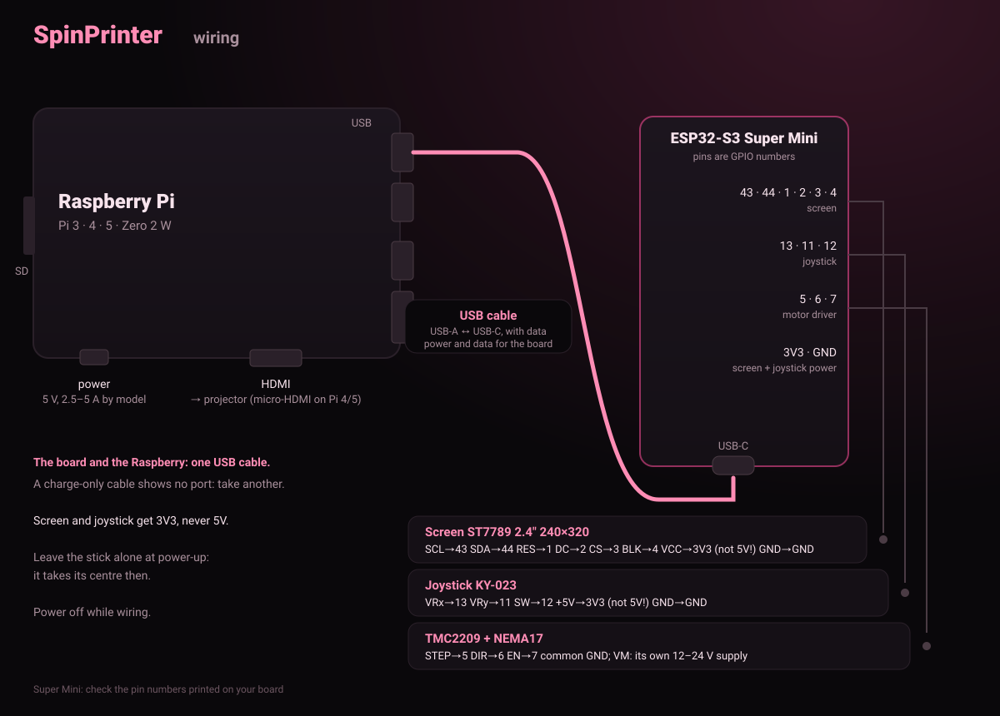
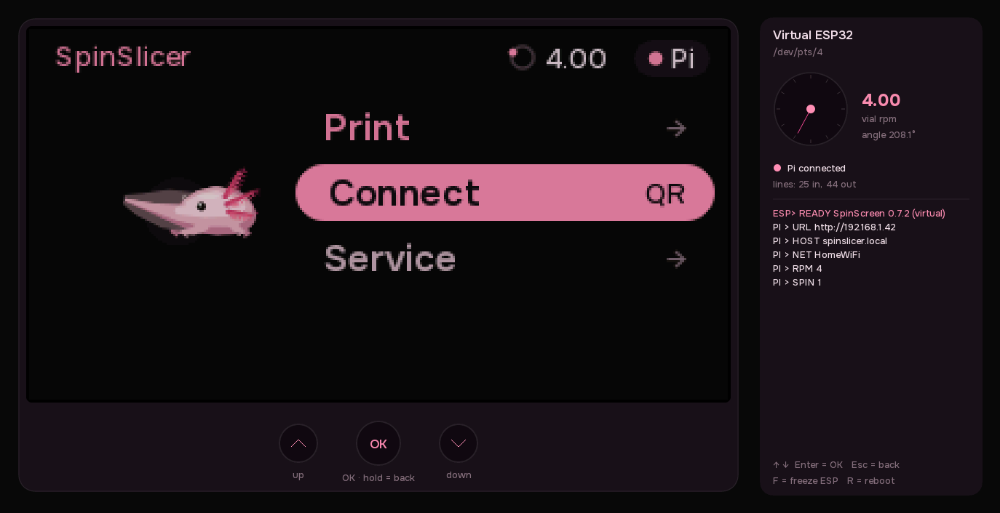

# SpinPrinter

[Русский](README.ru.md) · **English**

A volumetric (CAL) 3D printer for the [SpinSlicer](https://github.com/redbluecarrot/SpinSlicer) slicer.
A vial of resin spins, a projector shines frames onto it, and the whole part cures at once.
This repository is everything the printer itself needs: the screen and motor firmware, the
Raspberry Pi software, the angle-locked projector and a system image.

```
 SpinSlicer / phone ──Wi-Fi──► Raspberry Pi 3B ──HDMI──► projector
                                   │
                                   └──USB or 4 wires──► ESP32-S3 (screen, buttons, motor)
```

**The main difference from OpenCAL:** the projector shows the frame for the **vial's angle**, not
for the time. The ESP32 counts every motor step, and on every projector refresh the frame for
the current angle goes up. The video cannot drift, and the light goes off after exactly N turns.

## Install

Step by step for Windows, Mac and Linux: **[docs/INSTALL.md](docs/INSTALL.md)**. In short:

1. **Flash the ESP32-S3:** open the [browser flasher](https://v0xeii.github.io/SpinPrinter/) in Chrome or Edge
   → "Flash SpinScreen". No Arduino IDE needed.
2. **Set up the Raspberry Pi:**
   - any OS: Raspberry Pi Imager → Raspberry Pi OS Lite (64-bit) with your Wi-Fi and SSH, then one command on the Pi:
     ```bash
     curl -fsSL https://raw.githubusercontent.com/v0xeII/SpinPrinter/main/SpinPi/get.sh | sudo bash
     ```
   - Linux: all in one command on the computer, card in the reader: `sudo bash SpinPi/make_sd_card.sh`.
3. **Wire** it as below, switch on and open `http://spinslicer.local`.

## Wiring



The ESP32 and the Pi talk over a **USB cable or four wires**. Both work, nothing to switch: the
firmware listens on both and the Pi looks for the ESP on USB first, then on the wires.

| Raspberry Pi (outer header row, from the SD-card end) | ESP32-S3 Super Mini |
|---|---|
| pin 2 · 5V | 5V |
| pin 6 · GND | GND |
| pin 8 · GPIO14 TX | **RX** (GPIO44) |
| pin 10 · GPIO15 RX | **TX** (GPIO43) |

TX and RX **cross**. Both boards are 3.3 V, no level shifter. Power the Pi from a **5 V 2.5 A**
supply, or it reports "Undervoltage" and misbehaves.

## Printing from SpinSlicer over Wi-Fi

In SpinSlicer, on the Print step, pick **"to printer"** → **"Send to printer"**. The video goes
over **losslessly** together with the planned turns, and the print starts by itself (for now in the
slicer's `printer` branch). You can also drop a video on the printer page (`http://spinslicer.local`)
from any device on the same network, or bring it on a USB stick.

## What is here

| folder | what it is |
|---|---|
| [`SpinScreen_v0.7/`](SpinScreen_v0.7/README.en.md) | ESP32-S3 firmware: ST7789 screen, buttons, stepper motor, Spinny the axolotl |
| [`SpinPi/`](SpinPi/README.en.md) | the Pi software: printer web page, USB sticks, print jobs, ESP32 link, installers |
| [`SpinProj/`](SpinProj/README.en.md) | the projector: the frame for the vial angle on every vsync (C, DRM/KMS) |
| [`SpinOS/`](SpinOS/README.en.md) | a dedicated Pi 3B system image (Buildroot), not yet tried on hardware |
| [`flasher/`](flasher/index.html) | the browser flasher page (published on GitHub Pages) |
| [`dev/`](#the-whole-printer-on-a-pc) | the whole printer on a PC without hardware + a self-test |
| [`docs/plan.md`](docs/plan.md) | the project's first plan (touch panel, `.spincal` jobs), in Russian; `firmware/`, `pi/`, `system/`, `tests/` are its empty skeleton |

## The whole printer on a PC

No Pi, ESP32 or projector needed: the PC runs the **real screen UI** (the same code as the
firmware), SpinPi and SpinProj.



```bash
# Ubuntu / Debian
sudo apt install build-essential pkg-config liblz4-dev libsdl2-dev libdrm-dev ffmpeg python3-serial
# Manjaro / Arch
sudo pacman -S --needed base-devel lz4 sdl2 libdrm ffmpeg python-pyserial

python3 dev/bench.py      # screen and projector windows + the printer page in the browser
python3 dev/selftest.py   # self-test, about 2 minutes: "22 из 22 проверок прошли" (22 of 22 passed)
```

Screen keys: ↑ ↓, Enter = OK, Esc = back. **F** in the ESP32 window makes the board "hang": the
light must go off at once. In the test video the arrow in the corner points where the vial arrow does.

## Tested and not yet tested

| | |
|---|---|
| ✔ on a PC | ESP32 ↔ SpinPi ↔ SpinProj, angle-locked printing, faults, Wi-Fi page (self-test on every push) |
| ✔ real ESP32 | firmware 0.7.2 on the board; SpinPi on a PC + the board over USB: no missed frames, 0.5 ms angle jitter |
| ✔ SpinSlicer → printer | lossless video + plan → SpinPi on a PC → the print started by itself and ran to plan |
| ✔ Buildroot | SpinOS settings accepted by Buildroot 2026.02.3, SpinProj builds for the Pi (aarch64) |
| ✘ not yet | on a Pi 3B: projector output (DRM), speed, installation, the TX/RX wire link, the motor |
