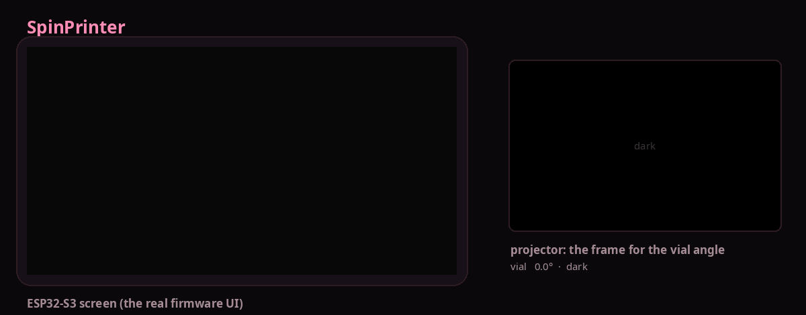

# SpinPrinter

[Русский](README.ru.md) · **English**

A volumetric 3D printer. A vial of resin turns slowly, a projector shines images onto it, and
the part sets inside all at once, with no layers. Models are prepared in the free slicer
[SpinSlicer](https://github.com/redbluecarrot/SpinSlicer) and sent to the printer over Wi-Fi.



## What the printer is made of

| part | what it does |
|---|---|
| **board with a screen** (ESP32-S3) | 2.4" screen and a joystick: the menu; turns the vial |
| **Raspberry Pi** + **projector** | keeps your prints, shows the images on the vial, serves the printer's page in a browser |
| **SpinSlicer** on a computer | turns a model into a `.spin` print file and sends it to the printer |

Any 64-bit Raspberry Pi works: 3, 3B+, 4, 400, 5, Zero 2 W. The board's parts are fixed: an
ESP32-S3 Super Mini, a 2.4" ST7789 screen (240×320) and a KY-023 joystick on wires, a TMC2209
motor driver, and a USB cable to the Pi.

## Getting started

Step by step, for Windows, Mac and Linux: **[the guide](docs/INSTALL.md)**. In short:

1. **The board.** Plug it into your computer and open the
   **[flasher page](https://v0xeii.github.io/SpinPrinter/flasher/)** in Chrome or Edge.
   Press "Flash". That is all: the screen works right after.
2. **Raspberry Pi.** Write Raspberry Pi OS Lite to a card with Raspberry Pi Imager, power the Pi
   and run one command from the guide on it.
3. **Connect** the board to the Pi with a USB cable and the projector to the Pi with HDMI, and
   power up. When "Pi" lights up on the printer's screen, you are ready.

## Printing

1. In SpinSlicer, connect the printer once (Settings → Printer: it finds it on the network and
   takes its projector, vial and calibration). On the last step press **"Print"**.
2. The printer's screen asks **"Print?"**: put the vial in and push the joystick right. No
   network? **"To USB stick"** in SpinSlicer, the stick into the Pi, then on the printer's screen
   **Print** → pick the part → **PRINT**.
3. When it is done, answer "Under / Good / Over": the printer adjusts the exposure for the next one.

The printer's page in a browser: **http://spinslicer.local** (or the QR code: printer screen →
Connect). Upload prints from a phone there and watch how the print goes.

## Wiring


The board and the Pi connect with a USB cable (a data cable, not a charge-only one). The screen
and the joystick take 3V3 from the board, never 5V.

---

## For developers

Inside, the printer is a few programs:

| folder | what it is |
|---|---|
| [`SpinScreen_v0.7/`](SpinScreen_v0.7/README.en.md) | the board's firmware (SpinScreen): screen, controls, motor, protocol with the Pi |
| [`SpinPi/`](SpinPi/README.en.md) | the Raspberry Pi program (SpinPi): printer page, USB sticks, printing, HTTP API |
| [`SpinProj/`](SpinProj/README.en.md) | projector output (SpinProj): the frame for the vial's angle on every refresh |
| [`flasher/`](flasher/index.html) | the board's flash and setup page (GitHub Pages) |
| [`dev/`](dev/) | the whole printer on a computer without hardware, and the self-test |
| [`docs/ecosystem.ru.md`](docs/ecosystem.ru.md) | how the slicer and the printer work together, the `.spin` format |

**Why the images never drift.** The board counts every motor step and knows the vial's angle. The
Raspberry Pi reads the angle 20 times a second, and the projector shows the image for that angle
on every refresh, not by time as OpenCAL does. The light goes off exactly after N turns.

**The whole printer on a computer.** No Pi, board or projector: the real screen interface (the same
code as the firmware), the Pi program and the projector in windows.

```bash
# Ubuntu / Debian
sudo apt install build-essential pkg-config liblz4-dev libsdl2-dev libdrm-dev ffmpeg python3-serial
# Manjaro / Arch
sudo pacman -S --needed base-devel lz4 sdl2 libdrm ffmpeg python-pyserial

python3 dev/bench.py      # the screen and projector windows + the printer's page in a browser
python3 dev/selftest.py   # self-test, about 2 minutes
```

**Tested:** the whole chain on a computer (self-test on every push); a real board with the Pi
program on a PC: printing without missed frames, 0.5 ms angle jitter; SpinSlicer → printer.
**Not yet tried on a real Pi:** projector output, installation, the motor.
