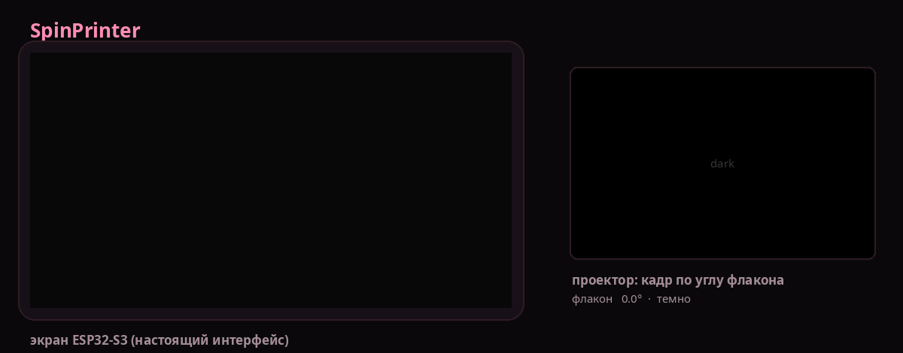
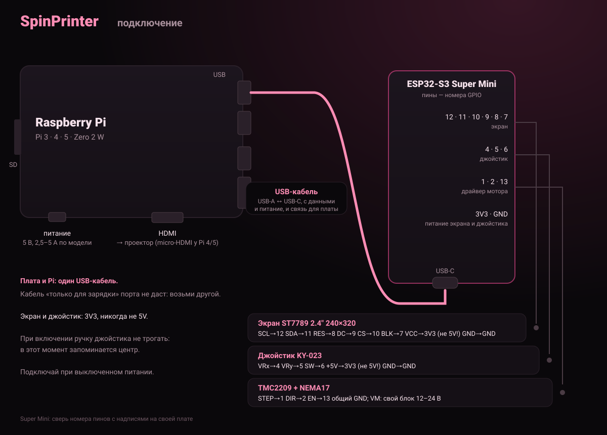
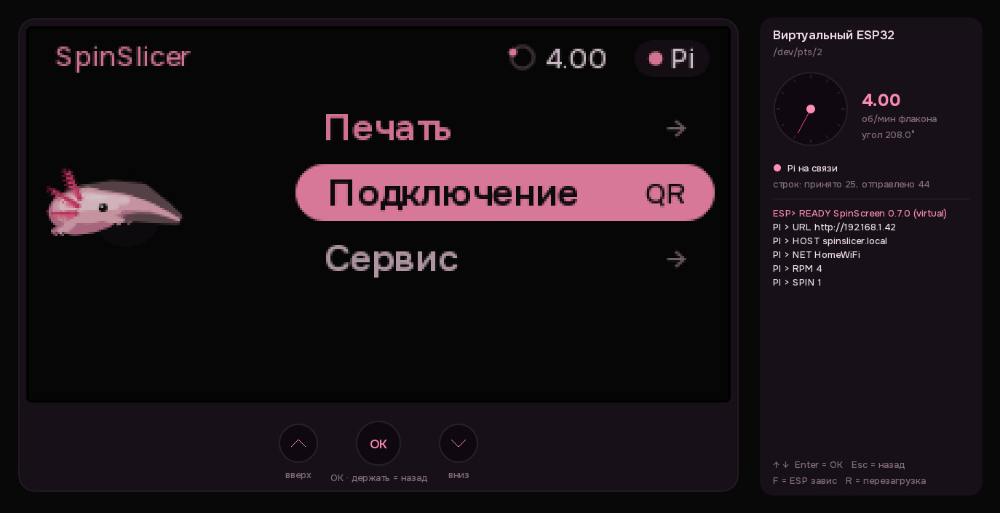

# SpinPrinter

**Русский** · [English](README.md)

Принтер объёмной печати (CAL) для слайсера [SpinSlicer](https://github.com/redbluecarrot/SpinSlicer).
Флакон со смолой вращается, проектор светит на него кадры, и деталь застывает целиком сразу.
Здесь всё, что нужно самому принтеру: прошивка экрана и мотора, программа для Raspberry Pi,
проектор «по углу» и свой образ системы.

```
 SpinSlicer / телефон ──Wi-Fi──► Raspberry Pi ──HDMI──► проектор
                                     │
                                     └──USB или 4 провода──► ESP32-S3 (экран, кнопки, мотор)
```



*Настоящий интерфейс прошивки (слева) на протяжении всей печати и то, что показывает проектор
(справа): кадр всегда соответствует углу флакона, свет горит только во время засветки.*

**Главное отличие от OpenCAL:** проектор показывает кадр **по углу флакона**, а не по времени.
ESP32 считает каждый шаг мотора, и на каждом обновлении проектора выводится кадр, который
относится к текущему углу. Видео не может «уплыть», а свет гаснет ровно через N оборотов.

## Установка

Подробно по шагам, для Windows, Mac и Linux: **[docs/INSTALL.ru.md](docs/INSTALL.ru.md)**. Коротко:

1. **Прошить ESP32-S3:** открыть [страницу-прошивальщик](https://v0xeii.github.io/SpinPrinter/flasher/) в Chrome или Edge
   → «Прошить SpinScreen». Arduino IDE не нужен.
2. **Подготовить Raspberry Pi:**
   - любая ОС: Raspberry Pi Imager → Raspberry Pi OS Lite (64-bit) с твоим Wi-Fi и SSH, затем на Pi одна команда:
     ```bash
     curl -fsSL https://raw.githubusercontent.com/v0xeII/SpinPrinter/main/SpinPi/get.sh | sudo bash
     ```
   - Linux: всё одной командой с компьютера, карта в картридере: `sudo bash SpinPi/make_sd_card.sh`.
3. **Соединить** по схеме ниже, включить и открыть `http://spinslicer.local`.

## Схема подключения



ESP32 и Pi соединяются **USB-кабелем или четырьмя проводами**. Работают оба способа, переключать
ничего не надо: прошивка слушает оба, а Pi ищет ESP сначала на USB, потом на проводах.

| Raspberry Pi (внешний ряд гребёнки от края у SD-карты) | ESP32-S3 Super Mini |
|---|---|
| пин 2 · 5V | 5V |
| пин 6 · GND | GND |
| пин 8 · GPIO14 TX | **RX** (GPIO44) |
| пин 10 · GPIO15 RX | **TX** (GPIO43) |

TX и RX соединяются **накрест**. Обе платы работают на 3,3 В, преобразователь уровней не нужен.
Гребёнка одинаковая на всех Pi с 40 пинами. Питание Pi — от блока под её модель, иначе будет
«Undervoltage» и сбои.

**Подходит любая 64-битная Raspberry Pi:** Pi 3, 3B+, 4, 400, 5, Zero 2 W. Питание и HDMI для
каждой модели: [docs/INSTALL.ru.md](docs/INSTALL.ru.md#какая-raspberry-pi-подойдёт).

## Печать из SpinSlicer по Wi-Fi

В SpinSlicer на шаге «Печать» выбери **«на принтер»** → **«Отправить на принтер»**. Слайсер сам
находит принтер в сети (mDNS, `_spinprinter._tcp`), забирает его профиль (проектор, флакон,
калибровка) и отправляет один файл **`.spin`**: видео одного оборота, превью детали и расчёт
оборотов. Файл `.spin` или видео можно перетащить и на страницу принтера (`http://spinslicer.local`)
с любого устройства в той же сети или принести на флешке. Как слайсер и принтер работают вместе:
[docs/ecosystem.ru.md](docs/ecosystem.ru.md); API принтера: [SpinPi/README.md](SpinPi/README.md#для-разработчиков-http-api).

## Что в репозитории

| папка | что это |
|---|---|
| [`SpinScreen_v0.7/`](SpinScreen_v0.7/README.md) | прошивка ESP32-S3: экран ST7789, кнопки, шаговый мотор, аксолотль Spinny |
| [`SpinPi/`](SpinPi/README.md) | программа для Pi: страница принтера, флешки, печать, связь с ESP32, установщики |
| [`SpinProj/`](SpinProj/README.md) | проектор: кадр по углу флакона на каждом vsync (C, DRM/KMS) |
| [`SpinOS/`](SpinOS/README.md) | свой образ системы (Buildroot, пока под Pi 3), не проверен на железе |
| [`flasher/`](flasher/index.html) | страница прошивки ESP из браузера (публикуется на GitHub Pages) |
| [`dev/`](#весь-принтер-на-компьютере) | весь принтер на компьютере без железа + автотест |
| [`docs/plan.md`](docs/plan.md) | первоначальный план проекта (сенсорная панель, формат `.spincal`); пустые `firmware/`, `pi/`, `system/`, `tests/` — его каркас |

## Весь принтер на компьютере

Без Pi, ESP32 и проектора: на компьютере запускаются **настоящий интерфейс экрана** (тот же код,
что в прошивке), SpinPi и SpinProj.



```bash
# Ubuntu / Debian
sudo apt install build-essential pkg-config liblz4-dev libsdl2-dev libdrm-dev ffmpeg python3-serial
# Manjaro / Arch
sudo pacman -S --needed base-devel lz4 sdl2 libdrm ffmpeg python-pyserial

python3 dev/bench.py      # окна экрана и проектора + страница принтера в браузере
python3 dev/selftest.py   # автотест, около 2 минут: «22 из 22 проверок прошли»
```

Кнопки экрана: ↑ ↓, Enter = OK, Esc = назад. **F** в окне ESP32 — плата «зависла»: свет должен
сразу погаснуть. В тестовом видео стрелка в углу кадра смотрит туда же, куда стрелка флакона.

## Что проверено, а что нет

| | |
|---|---|
| ✔ на компьютере | ESP32 ↔ SpinPi ↔ SpinProj, печать по углу, аварии, Wi-Fi страница (автотест на каждый push) |
| ✔ настоящий ESP32 | прошивка 0.7.2 на плате; SpinPi на ПК + плата по USB: печать без пропусков, разброс угла 0,5 мс |
| ✔ SpinSlicer → принтер | видео без потерь + план → SpinPi на ПК → печать стартовала сама и прошла по плану |
| ✔ Buildroot | настройки SpinOS приняты Buildroot 2026.02.3, SpinProj собирается под Pi (aarch64) |
| ✘ ещё не проверено | на настоящей Pi: вывод на проектор (DRM), скорость, установка, связь по проводам TX/RX, мотор |
