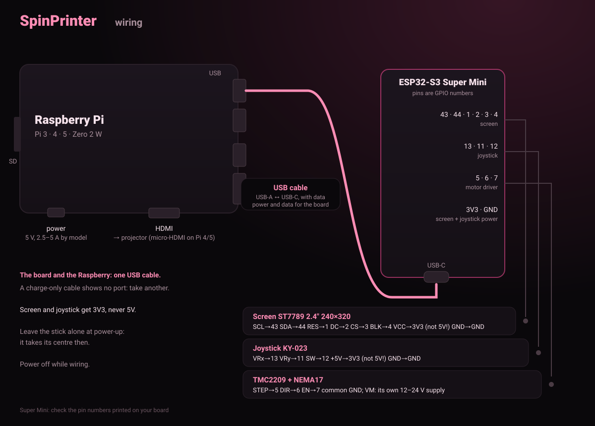

# Installing SpinPrinter

[Русский](INSTALL.ru.md) · **English**

You need: a Raspberry Pi (3, 3B+, 4, 5 or Zero 2 W, see below) with its own power supply, an
8–32 GB microSD card, an ESP32-S3 Super Mini board with a 2.4" ST7789 screen and a KY-023 joystick, a USB cable
that carries data, a projector with HDMI. And a computer with Windows, Mac or Linux.

## Which Raspberry Pi

Any 64-bit Raspberry Pi works: the software and the wiring are the same.

| model | power supply | HDMI to the projector | board by USB cable |
|---|---|---|---|
| Pi 3 / 3B+ | micro-USB, 5 V 2.5 A | full-size HDMI | any USB-A port |
| Pi 4 / 400 | USB-C, 5 V 3 A | micro-HDMI (cable or adapter) | any USB-A port |
| Pi 5 | USB-C, 5 V 5 A (27 W) | micro-HDMI (cable or adapter) | any USB-A port |
| Pi Zero 2 W | micro-USB, 5 V 2.5 A | mini-HDMI (adapter) | USB OTG adapter |

Not supported: the first Raspberry, Pi 2 and the first Pi Zero (32-bit only, the Zero has one core).
The faster the Raspberry, the more images per turn it can keep up with.

## 1. Flash the board

**In the browser (Windows, Mac, Linux, nothing to install):**
1. Plug the board into the computer with a USB cable **that carries data**.
2. Open **https://v0xeii.github.io/SpinPrinter/flasher/** in Chrome or Edge.
3. "Flash the board" → pick the port `USB JTAG/serial debug unit` (`COM…` on Windows) → "Install".
   When flashing is done, the printer's menu appears on the screen. Nothing else to set up.
   Leave the joystick alone at power-up: it takes its centre then.

**Black screen?** Check the screen's wires against the picture in step 3 (and VCC on 3V3).

No port in the list: the cable only charges, use another one. Flashing fails: hold **BOOT**,
press and release **RESET**, release BOOT and try again.

**For developers (Linux, Arduino IDE 2 with the esp32 core):** `bash SpinScreen_v0.7/tools/flash.sh`

## 2. Set up the Raspberry Pi

### Way A: any OS (Raspberry Pi Imager)
1. Install [Raspberry Pi Imager](https://www.raspberrypi.com/software/).
2. Device: **your Raspberry Pi model**. OS: **Raspberry Pi OS (other) → Raspberry Pi OS Lite (64-bit)**. Storage: your microSD.
3. "Edit settings":
   - hostname: `spinslicer`
   - a user name and password (remember them)
   - Wi-Fi: network name, password, your country
   - "Services": enable SSH (password)
4. "Write". Put the card in the Raspberry, power it and wait 3 minutes.
5. On the computer open a terminal (Windows: **PowerShell**) and log in to the Raspberry:
   ```
   ssh user@spinslicer.local
   ```
   Answer `yes` to the "yes/no" question, then type the password (it does not show, that is normal).
6. One command on the Raspberry (10–20 minutes, the Raspberry reboots at the end):
   ```bash
   curl -fsSL https://raw.githubusercontent.com/v0xeII/SpinPrinter/main/SpinPi/get.sh | sudo bash
   ```
   It installs the printer software, keeps the projector black until a print and gets the Raspberry ready
   for the board. It takes the latest release, the same version the flasher puts on the board.
   Run the same command again any time to update.

### Way B: Linux, one command on the computer
With the card in the reader, from the SpinPrinter folder:
```bash
sudo bash SpinPi/make_sd_card.sh
```
It finds the card and asks you to type "yes", wipes it, writes Raspberry Pi OS Lite, asks for your Wi-Fi
(only you see the password) and sets up SSH login with this computer's key, no password. The Raspberry
installs the printer software by itself on the first start: 10–20 minutes, keep it powered meanwhile.

## 3. Wire it up



- **Board ↔ Raspberry:** a USB cable (the board's USB-C to any Raspberry USB port).
- **Screen ST7789 2.4":** SCL→43, SDA→44, RES→1, DC→2, CS→3, BLK→4, VCC→3V3 (not 5V!), GND.
- **Joystick KY-023:** VRx→13, VRy→11, SW→12, +5V→3V3 (not 5V!), GND.
- **Projector:** HDMI to the Raspberry.
- **Raspberry power:** the supply for your model (table above). A phone charger with a thin cable often gives "Undervoltage".
- **Motor:** TMC2209 driver: STEP→5, DIR→6, EN→7, common GND; the motor has its own 12–24 V supply.

Wire everything with the power off.

## 4. First print

1. Switch the Raspberry on. When the printer's screen says **"Raspberry connected"**, it is ready. (The screen speaks English
   and Russian: Settings → Display → Language.)
2. Open `http://spinslicer.local` (or scan the QR code: printer screen → Connect).
3. **Settings → Projector** on the printer's screen: "Grid" and "Centering" to focus and find the vial axis.
4. In SpinSlicer: Settings → Printer → **"Connect"**, then on the Print step → **"Print"**. The
   printer's screen asks "Print?": put the vial in and push the joystick right. Or **"To USB stick"**
   and the stick into the Raspberry, or drop the `.spin` file on the printer page.
5. After the print, answer "Under / Good / Over" on the screen: the printer adjusts the exposure itself.

## Troubleshooting

| you see | do this |
|---|---|
| black screen after flashing | check the screen's wires (step 3) and that VCC is on 3V3; long wires: try a shorter cable |
| no "Raspberry connected" | wait 20 minutes after the first start; check that the USB cable carries data |
| "Undervoltage" on a monitor | the right supply for your model (table above), a short thick cable without adapters |
| `spinslicer.local` does not open | are the PC and the Raspberry on the same network? On Windows without Bonjour use the IP from the printer's screen |
| way B: the Raspberry did not come up | put the card in a computer: the `bootfs` partition holds a boot diary, `spinprinter-log.txt` |
| service log | `ssh pi@spinslicer.local journalctl -u spinpi -n 50` |
| can the Raspberry keep up with the frames | `sudo systemctl stop spinpi && sudo /opt/spinpi/spinproj bench --rt --cpu 3` |
