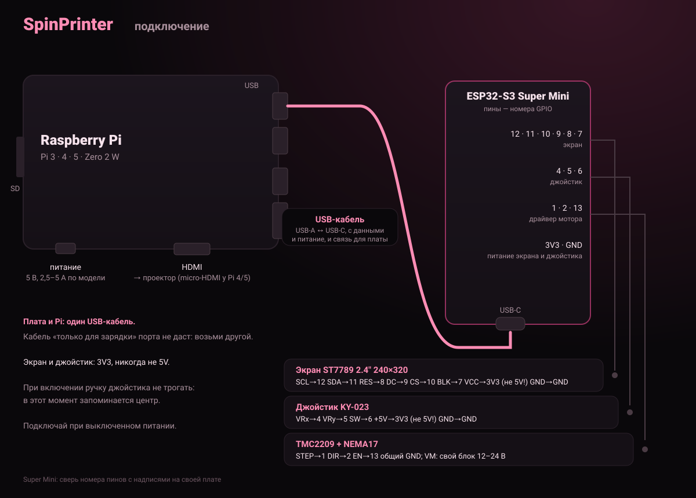

# Установка SpinPrinter

**Русский** · [English](INSTALL.md)

Нужно: Raspberry Pi (3, 3B+, 4, 5 или Zero 2 W, см. ниже) со своим блоком питания, microSD 8–32 ГБ,
плата ESP32-S3 Super Mini с экраном и кнопками (или джойстиком, или крутилкой), кабель USB
с данными, проектор с HDMI.
Компьютер с Windows, Mac или Linux.

## Какая Raspberry Pi подойдёт

Подходит любая 64-битная Raspberry Pi с гребёнкой на 40 пинов: программы и провода одни и те же.

| модель | питание | HDMI к проектору | плата по USB-кабелю |
|---|---|---|---|
| Pi 3 / 3B+ | micro-USB, 5 В 2,5 А | обычный HDMI | любой порт USB-A |
| Pi 4 / 400 | USB-C, 5 В 3 А | micro-HDMI (кабель или переходник) | любой порт USB-A |
| Pi 5 | USB-C, 5 В 5 А (27 Вт) | micro-HDMI (кабель или переходник) | любой порт USB-A |
| Pi Zero 2 W | micro-USB, 5 В 2,5 А | mini-HDMI (переходник) | переходник USB OTG или 4 провода |

Не подойдут: первая Pi, Pi 2 и первая Pi Zero (только 32 бита, у Zero одно ядро).
Чем быстрее Pi, тем больше картинок на оборот она успевает показывать.

## 1. Прошить и настроить плату

**Через браузер (Windows, Mac, Linux, ничего ставить не нужно):**
1. Подключи плату к компьютеру USB-кабелем **с данными**.
2. Открой **https://v0xeii.github.io/SpinPrinter/flasher/** в Chrome или Edge.
3. «Прошить плату» → выбери порт `USB JTAG/serial debug unit` (на Windows `COM…`) → «Install».
   Когда прошивка закончится, закрой окно прошивки.
4. Ниже на той же странице: «Подключиться» → выбери свой **экран** и **управление** (кнопки,
   джойстик или крутилка). Страница покажет, какие провода куда идут, проверь их.
5. «Записать в плату». Плата перезагрузится, и на экране появится меню принтера.

**Экран чёрный?** Значит, пропущен шаг 4: прошивка одна для всех экранов и не знает, какой у тебя,
пока его не выбрать. Его же можно поменять в любой момент, без новой прошивки.

Порта нет в списке — кабель «только для зарядки», возьми другой. Не прошивается — зажми **BOOT**,
нажми и отпусти **RESET**, отпусти BOOT и попробуй снова.

**Для разработчиков (Linux, Arduino IDE 2 с ядром esp32):** `bash SpinScreen_v0.7/tools/flash.sh`

## 2. Подготовить Raspberry Pi

### Способ А: любая ОС (Raspberry Pi Imager)
1. Поставь [Raspberry Pi Imager](https://www.raspberrypi.com/software/).
2. Устройство: **твоя модель Raspberry Pi**. ОС: **Raspberry Pi OS (other) → Raspberry Pi OS Lite (64-bit)**. Карта: твоя microSD.
3. «Изменить настройки»:
   - имя хоста: `spinslicer`
   - имя пользователя и пароль (запомни их)
   - Wi-Fi: имя сети, пароль, страна RU
   - «Службы»: включить SSH (по паролю)
4. «Записать». Карту в Pi, подключи питание и подожди 3 минуты.
5. На компьютере открой терминал (Windows: **PowerShell**) и зайди на Pi:
   ```
   ssh имя@spinslicer.local
   ```
   На вопрос «yes/no» ответь `yes`, потом введи пароль. Буквы при вводе не видны, это нормально.
6. На Pi одна команда (10–20 минут, в конце Pi перезагрузится):
   ```bash
   curl -fsSL https://raw.githubusercontent.com/v0xeII/SpinPrinter/main/SpinPi/get.sh | sudo bash
   ```
   Она поставит программу принтера, сделает так, чтобы проектор был чёрным до печати, и
   подготовит Pi к работе с платой. Ту же команду можно запустить ещё раз, чтобы обновиться.

### Способ Б: Linux, одной командой с компьютера
Карта в картридере, из папки SpinPrinter:
```bash
sudo bash SpinPi/make_sd_card.sh
```
Скрипт найдёт карту и спросит «да». Он сотрёт всё старое, запишет Raspberry Pi OS Lite, спросит
твой Wi-Fi (пароль видно только тебе), включит вход по SSH-ключу этого компьютера без пароля.
Программу принтера Pi поставит сама при первом включении: 10–20 минут, не выключай её это время.

## 3. Соединить



- **Плата ↔ Pi:** USB-кабель (USB-C платы в любой USB-порт Pi). Если экран подключён проводами,
  можно и 4 проводами к гребёнке Pi: пин 2 → 5V, пин 6 → GND, пин 8 (TX) → RX, пин 10 (RX) → TX,
  TX и RX накрест. Если экран воткнут в макетку рядом с платой, только кабель: эти пины заняты экраном.
- **Проектор:** HDMI в Pi.
- **Питание Pi:** блок под твою модель (таблица выше). Телефонный зарядник с тонким кабелем часто даёт «Undervoltage».
- **Мотор (потом):** драйвер TMC2209: STEP, DIR и EN на пины, которые показывает страница прошивки для твоей
  схемы, GND общий; мотор питается от своего блока 12–24 В.

Соединяй при выключенном питании.

## 4. Первая печать

1. Включи Pi. Когда на экране принтера появится **«Pi подключена»**, всё готово.
2. Открой `http://spinslicer.local` (или QR-код: экран принтера → Подключение).
3. **Сервис → Проектор** на экране принтера: «Сетка» и «Центровка», чтобы навести резкость и найти ось флакона.
4. В SpinSlicer: «Печать» → **«отправить на принтер»**. Или перетащи файл `.spin` на страницу
   принтера, или принеси его на флешке.
5. После печати ответь на экране «Недосвет / Норма / Пересвет»: принтер сам поправит экспозицию.

## Если что-то не так

| что видно | что делать |
|---|---|
| экран чёрный после прошивки | на странице прошивки шаг «Какой у тебя экран»: выбери экран и нажми «Записать в плату» |
| нет «Pi подключена» | подожди 20 минут после первого включения; проверь кабель (с данными) или провода TX/RX накрест |
| «Undervoltage» на мониторе | блок питания под твою модель (таблица выше), короткий толстый кабель без переходников |
| `spinslicer.local` не открывается | компьютер и Pi в одной сети? На Windows без Bonjour попробуй IP с экрана принтера (Подключение) |
| способ Б: Pi не поднялась | вынь карту, вставь в компьютер: на разделе `bootfs` лежит дневник `spinprinter-log.txt` |
| журнал службы | `ssh pi@spinslicer.local journalctl -u spinpi -n 50` |
| успевает ли Pi показывать кадры | `sudo systemctl stop spinpi && sudo /opt/spinpi/spinproj bench --rt --cpu 3` |
